# Architecture

```mermaid
flowchart TD
    U(["User input: chat box<br/>literature question, 1 sentence to 1 paragraph<br/>+ effort level: Normal / Medium / High / Ultra"])

    subgraph PL["1. Planner agent"]
        P0{"Clear literature<br/>topic?"}
        P1["Extract search criteria<br/>relevance, recency, citation count,<br/>primary vs review papers"]
        P2{"Criteria given<br/>by user?"}
        P3["Use user's criteria"]
        P4["Apply default criteria"]
        P5["Search plan JSON<br/>token budget set by effort level"]
        P0 -- "Yes" --> P1 --> P2
        P2 -- "Yes" --> P3 --> P5
        P2 -- "No" --> P4 --> P5
    end

    ASK["Friendly prompt asking the user<br/>to state or choose a topic"]

    subgraph RT["2. Retriever agent"]
        R0{"Signed in with<br/>school account?"}
        R1["Open-access papers only<br/>OpenAlex · Semantic Scholar · arXiv APIs"]
        R2["Open-access + institutional papers"]
        R0 -- "No" --> R1
        R0 -- "Yes" --> R2
    end

    Z[("Zetaris<br/>shared paper data layer")]

    M[("Meterless world model<br/>shared graph: papers, clusters,<br/>connections, gaps")]

    H1{"Human review 1<br/>summary + paper list<br/>relevant? any preferences<br/>on years, citations, paper type?"}

    subgraph CL["3. Clusterer agent"]
        C0{"Effort level"}
        C1["Normal / Medium<br/>paper metadata only"]
        C2["High / Ultra<br/>full-text PDFs, read in chunks<br/>via Meterless Markovian engine"]
        C3["Cluster by paper similarity<br/>cosine similarity ≥ 0.7"]
        C4["Label each cluster"]
        C0 -- "Normal / Medium" --> C1 --> C3
        C0 -- "High / Ultra" --> C2 --> C3
        C3 --> C4
    end

    E1{"Grading agent<br/>cluster score ≥ threshold?"}

    subgraph CF["4. Connection finder agent"]
        CF1["Connections within each cluster"]
        CF2["Connections between clusters"]
        CF1 --> CF2
    end

    E2{"Grading agent<br/>connection score ≥ threshold?"}

    subgraph GF["5. Gap finder agent"]
        GF1["Gaps within a cluster<br/>between papers in a set similarity range"]
    end

    E3{"Grading agent<br/>gap score ≥ threshold?"}

    OUT["Front-end UI<br/>paper map: clusters, connections, gaps"]
    H2{"Human review 2<br/>thumbs up / down + follow-up request"}
    DONE(["Done"])

    U --> P0
    P0 -- "No: missing or generic" --> ASK --> U
    P5 --> R0
    R1 --> Z
    R2 --> Z
    Z --> H1
    H1 -- "Adjust: feedback" --> P1
    H1 -- "Satisfied" --> C0
    Z -.->|paper data| C0
    C4 --> E1
    E1 -- "Fail: redo" --> C3
    E1 -- "Pass" --> CF1
    CF2 --> E2
    E2 -- "Fail: redo" --> CF1
    E2 -- "Pass" --> GF1
    GF1 --> E3
    E3 -- "Fail: redo" --> GF1
    E3 -- "Pass" --> OUT
    OUT --> H2
    H2 -- "Satisfied" --> DONE
    H2 -- "Follow-up: feedback" --> P1

    C4 -.->|write clusters| M
    CF2 -.->|write connections| M
    GF1 -.->|write gaps| M
    M -.->|render graph| OUT

    classDef io fill:#e8e8e8,stroke:#666666,color:#1a1a1a
    classDef agent fill:#cfe8ff,stroke:#2b6cb0,color:#0b2540
    classDef evaluator fill:#ffd9d2,stroke:#c0392b,color:#4a1209
    classDef human fill:#ffe9b3,stroke:#b7791f,color:#3d2a05
    classDef data fill:#d5f5e3,stroke:#1e8449,color:#0b3d20

    class U,ASK,OUT,DONE io
    class P0,P1,P2,P3,P4,P5,R0,R1,R2,C0,C1,C2,C3,C4,CF1,CF2,GF1 agent
    class E1,E2,E3 evaluator
    class H1,H2 human
    class Z data
    classDef meterless fill:#e4dcff,stroke:#6b46c1,color:#2a1458
    class M meterless
```

**Legend:** blue = agent steps, red = grading agents, yellow = human-in-the-loop review, green = Zetaris data layer, purple = Meterless world model, grey = user input and output. Dotted lines show data reads and writes.

## Sponsor technology

- **Zetaris** serves the raw paper data (metadata and PDFs) to every agent.
- **Meterless world model** holds what the agents work out: each agent writes its findings (clusters, connections, gaps) to one shared graph, the next agent reads from it, and the front end renders it as the paper map.
- **Meterless Markovian engine** processes full-text PDFs in chunks for High / Ultra effort, carrying compressed state between chunks so long papers don't overflow the context window.

## Design decisions

- **Single chat box input.** No Google Scholar-style filter controls; the Planner reads year, citation and paper-type preferences from natural language.
- **No topic, no error.** The agent asks for a topic in a friendly way instead of guessing one.
- **Preferences come after the first results.** The user sees a short list of relevant papers first, then is invited to refine years, citations or paper type at Human review 1.
- **No grading agent on retrieval for now.** Human review 1 covers it; an automated check can come later.
- **Contradiction detection dropped.** Its definition was too vague and risked fabricated conflicts, so it is out of scope for this version.

## Default search criteria

Used by the Planner when the user doesn't specify. Starting points to tune.

| Criterion | Default |
| --- | --- |
| Relevance | Top results by search-API ranking, then keep the papers most similar to the question (embedding cosine ≥ 0.5) |
| Recency | No limit unless the user gives years |
| Citations | No hard minimum; rank by citations per year so recent papers aren't penalised |
| Paper type | Both primary and review papers |

| Effort level | Papers retrieved | Input to later agents |
| --- | --- | --- |
| Normal | ~30 | Metadata |
| Medium | ~60 | Metadata |
| High | ~100 | Full-text PDFs |
| Ultra | ~150 | Full-text PDFs |

The 0.7 cosine threshold depends on the embedding model, so check it on a sample before fixing it.
