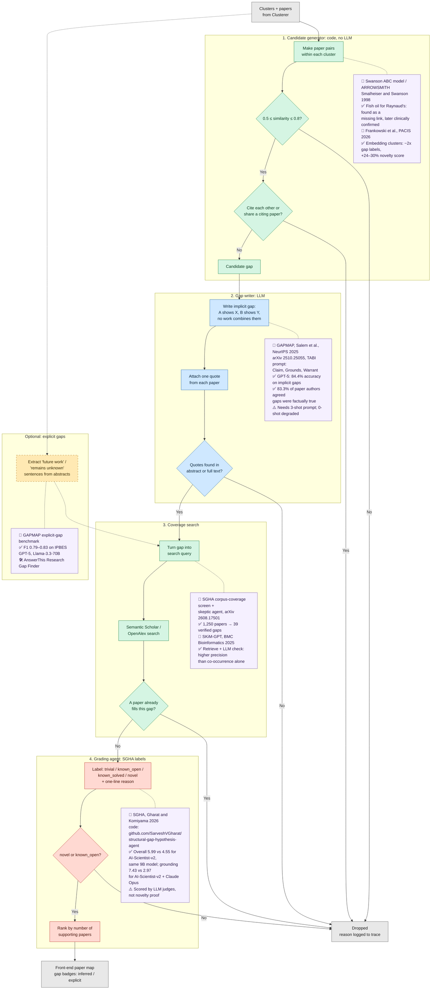

# 5. Gap finder agent

Code: `litagent/agents/gap_finder.py`.
Prompts: `prompts/gap_finder.md` (gap writer), `prompts/gap_coverage.md` (coverage judge),
`prompts/gap_grader.md` (grading agent), `prompts/gap_explicit.md` (optional explicit gaps).
Settings: `gap_*` fields in `litagent/config.py`.

**Agent Loop Spec**

1. **Goal:** Find pairs of related papers in one cluster that nothing has combined yet, each with a quote from both papers, checked against a literature search and labelled.
2. **Plan (≤5 steps):** `[code]` candidate generator (similarity band, citation checks, cap) → `[LLM]` gap writer (claim, grounds, warrant; `[code]` checks the quotes) → `[code]` coverage search + `[LLM]` coverage judge → `[LLM]` grading agent labels (`[code]` keeps novel and known_open, ranks, caps) → `[code]` write gaps to the world model.
3. **Tools:** `search_openalex` / `search_semantic_scholar` → query → papers → one attempt with a deadline; failure marks the gap `unavailable`. `complete_json` → payload → validated JSON → one repair.
4. **Memory kept:** gaps and dependencies → world model and map version; every kept or dropped item → trace; completed tasks → task cache (coverage expires after a day).
5. **Rubric (0–3 × 3):** accuracy (claim matches both quotes), appropriateness (a real, non-trivial gap not already filled), actionability (a researcher could start from it); see `prompts/grader.md`.
6. **Stop conditions:** a gap the grading agent flags is rewritten once, then dropped; stage grade < 7/9 → redo once with the fix → continue with a warning.
7. **Run log:** one line per item per stage (stage, gap id, decision, reason); progress events `start`, `partial_result` (gaps per cluster) and `done`.
8. **Guardrails:** at most `gap_max_per_cluster × 3` candidates per cluster reach the LLM; time limit and token budget checked before every call; failed searches are never treated as evidence of a gap.

## 1. Definition of a gap

A gap is a pair of papers in the same cluster that are close enough to plausibly combine, but
that nothing in the literature has combined yet:

$$
\text{gap}(a,b) \iff 0.5 \le \cos(e_a, e_b) \le 0.8 \;\wedge\; a \not\to b \,\wedge\, b \not\to a \;\wedge\; \nexists\, p : p \to a \,\wedge\, p \to b \;\wedge\; \text{coverage search} = \varnothing
$$

- $0.5 \le \cos(e_a, e_b)$: the lower bound excludes unrelated pairs.
- $\cos(e_a, e_b) \le 0.8$: the upper bound excludes near-duplicates.
- $a \not\to b \wedge b \not\to a$: neither paper cites the other, so the field has not already connected them directly.
- $\nexists\, p : p \to a \wedge p \to b$: no paper in our retrieved set cites both, so no later work has already put them side by side.
- $\text{coverage search} = \varnothing$: a literature search finds no paper that already fills the gap.

$e_a$ is paper $a$'s embedding (the Clusterer's similarity matrix) and $p \to a$ means $p$ cites $a$.
The 0.5–0.8 range is a draft to tune (`gap_similarity_min`, `gap_similarity_max`).

## 2. Pipeline

Legend: green = plain code, blue = LLM gap writer, red = grading agent, yellow dashed = optional explicit-gap path, purple = source and evidence for that stage.

## 3. Stages

Every stage writes one line per kept or dropped item to `logs/trace-<run_id>.jsonl`, with the
stage name, gap id, decision and reason.

**1. Candidate generator (code, no LLM).** Input: the Clusterer's clusters, its similarity matrix,
and each paper's reference list (OpenAlex `referenced_works`). It makes every pair of papers within
one cluster and keeps a pair when its cosine similarity is between `gap_similarity_min` and
`gap_similarity_max`, neither paper cites the other, and no retrieved paper cites both. Papers from
Semantic Scholar or arXiv have no stored reference list; their pairs are kept with
`citation_check: "unknown"` rather than failing. `passed` means both papers' lists were checked; a
third retrieved paper without a list can't be checked as a shared citer. Candidates are sorted by
similarity and capped at `gap_max_per_cluster × gap_candidate_multiplier` (5 × 3) per cluster before
any LLM call. Output: candidate pairs. Drops: no text to quote, out of range, a direct citation, a
shared citing paper, or over the cap.

**2. Gap writer (LLM).** Input: each candidate pair with source spans from both papers. Following
GAPMAP's Claim / Grounds / Warrant shape, with three worked examples (3-shot), it writes a `claim`
("paper A shows X, paper B shows Y, no work combines them"), `grounds` (one quote from each paper,
selected as a source span) and a `warrant` (why the grounds imply the gap), plus a short
`coverage_query` for stage 3. Code then runs the Connection finder's verbatim quote check: each
quote must be an original span of its own paper's abstract or full text. Each draft is checked on
its own, so one bad quote drops only that gap. Output: written gaps. Drops: the writer abstains, a
quote fails the check, or the claim asserts full-parameter tuning that neither quote states.

**3. Coverage search.** Input: each written gap and its `coverage_query`. It searches OpenAlex, and
Semantic Scholar too when `SEMANTIC_SCHOLAR_API_KEY` is set, and gives the top 5 results that are
not paper A or B to an LLM judge, which decides whether any of them already does what the claim says
is missing. Output: gaps with `coverage_status`. Drops: a result already fills the gap (the filling
paper's id, title and quote are logged). "Filled" needs a quote from that result; without a valid
one the gap is kept as `not_filled`. A failed search marks the gap `unavailable`, which is never
treated as evidence that the gap is open. Turned off with `gap_coverage_check=False`.

**4. Grading agent.** Input: surviving gaps with their quotes and coverage results. Using SGHA's
classifier labels, it labels each gap `trivial`, `known_open`, `known_solved` or `novel` with a
one-sentence reason. It keeps `novel` and `known_open`, ranks `novel` first and then by similarity,
and caps the result at `gap_max_per_cluster` per cluster. When the claim misstates its grounds, the
grading agent returns a fix, and that gap is rewritten once with the fix and checked again. Output:
the final gaps for the paper map. Drops: `trivial`, `known_solved`, no label returned, over the cap,
or still flawed after the one retry. The orchestrator's stage grade (0–9) still runs afterwards, as for every finding agent.

**Optional: explicit gaps** (`gap_explicit_enabled=True`, off by default). Input: each paper's
abstract. The LLM selects sentences that state missing knowledge ("remains unknown", "future work",
"has not been studied") as verbatim spans. These single-paper gaps skip stages 1 and 2 and go
straight to the coverage search and grading agent. Output: gaps with `gap_type: "explicit"`. Drops:
the same as stages 3 and 4.

**Request size.** The writer, the coverage judge and the grading agent send at most `gap_llm_batch_size` (5)
candidates or gaps per request, so each stays well inside the 90 s model limit, and each finished cluster's gaps
are kept as a partial result if a later request fails (a real run on 26 Oct lost 9 finished gaps to one timeout
of a 15-candidate request).

**Inputs (spec H4).** The gap writer and the grading agent also receive every cluster's card (see the
[Clusterer](clusterer.md#analysis-depth-and-cluster-cards-spec-h)) as context. Quotes come only from the
candidate's own two papers: full-text passages for main and foundation papers, abstracts for side papers.

**Escalation (spec H5).** In full-text modes, when a side cluster ends up holding kept gaps, the gap finder reads
full text for its top papers by citations (`gap_escalation_papers`, 3; at most `gap_escalation_max_clusters`, 1,
per run), logs it, and redoes that cluster's gaps on the full text. The fetched text is kept with the version so
the quotes stay checkable. Metadata modes never escalate.

In sample mode (`SAMPLE_MODE=true`, no network or LLM), stage 1 runs for real on the OpenAlex
reference lists stored in `data/sample/*.json` and the similarity matrices in
`data/sample/similarity/`, both made by `scripts/build_sample_gap_inputs.py`. Stages 2–4 return
placeholders labelled "Sample mode", and the coverage search is `skipped`.

## 4. Prior work and how we differ

Gap detection itself is not new. Literature-based discovery has looked for missing links between
literatures since Swanson's work in the 1980s, GAPMAP benchmarks LLMs on explicit and implicit gaps,
SGHA screens structural gaps against the corpus with a skeptic agent, and tools such as AnswerThis
offer gap finding to end users. What we combine is inferred gaps from our similarity-plus-citation
rule, a verbatim quote for each side, a coverage search, SGHA-style labels, and an interactive paper
map with human review.

## 5. Known limits

- GAPMAP's implicit-gap accuracy depended on a 3-shot prompt; zero-shot output degraded. Our prompt is 3-shot, but its examples are invented and untested against GAPMAP's benchmark.
- SGHA's results are scored by LLM judges and do not prove external novelty. Our `novel` label is a model judgment too.
- Our coverage search only checks what Semantic Scholar / OpenAlex return for one query: the top 5 results, not the whole literature. It also does not check our own retrieved papers beyond the citation rule in stage 1.
- Reference lists come only from OpenAlex. Pairs involving Semantic Scholar or arXiv papers are marked `citation_check: "unknown"`.
- The 0.5–0.8 similarity range is a draft and has not been tuned for our embedding model.

## 6. References

- GAPMAP: <https://arxiv.org/abs/2510.25055>
- SGHA: <https://arxiv.org/abs/2608.17501> and <https://github.com/SarveshVGharat/structural-gap-hypothesis-agent>
- SKiM-GPT: <https://www.ncbi.nlm.nih.gov/pmc/articles/PMC12829140/>
- Frankowski et al., PACIS 2026: <https://aisel.aisnet.org/pacis2026/adv_theory/adv_theory/7/>
- LBD and the fish oil / Raynaud's example: <https://arxiv.org/abs/2502.16450>
- ARROWSMITH, in the hypothesis generation survey: <https://arxiv.org/abs/2504.05496>
- AnswerThis Research Gap Finder: <https://answerthis.io/blog/research-gap-finder>
